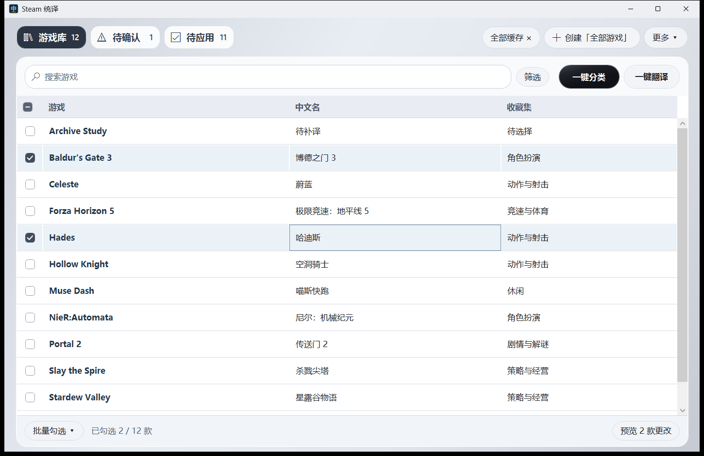
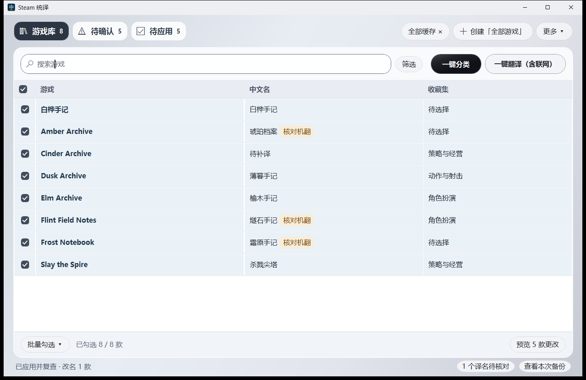

# Steam 统译 2.8

给 Steam 游戏补上中文名，再把游戏放入便于查找的收藏集。这个 Windows x64 便携版已在 Windows 11 x64 上验证，解压即可使用。

**[下载 Windows x64 便携版](https://github.com/chenran0408/steam-unify-desktop/releases/latest)**。在下载页选择文件名以 `-win-x64.zip` 结尾的压缩包，完整解压后双击 `SteamUnify.exe`。

## 快速开始

1. 完整解压 Windows x64 便携包，双击 `SteamUnify.exe`。游戏库显示「游戏」「中文名」「收藏集」三列。点击游戏名即可编辑。
2. 列表默认全选。只想整理几款时，点第一款的中文名或收藏集，再按住 `Ctrl` 点其他游戏。带勾、底色为浅蓝的游戏会参与当前操作。点「一键分类」整理收藏集，点「一键翻译」应用可信中文名。
   若还需后台补译，窗口底部会显示进度。完成后可直接点待核对数量，在主窗口逐项确认本次找到的译名。
3. 点「预览」可在主窗口选择改名或归类，再决定要应用的项目。Steam 正在运行时，程序会先在主窗口征求同意，再退出 Steam 并写入。请先保存游戏进度。

## 筛选和核对

按 `Ctrl+F` 搜索名称、标签或 AppID。要找指定的几款游戏，可以把多个 Steam AppID 一次粘进搜索框，用逗号、空格或换行分开。「筛选」可组合选择「仅已安装」和建议收藏集。「待确认」可以按缺中文名、待选收藏集或机翻译名查找。点击游戏名后可连续核对。「待应用」列出有可采用的中文名或收藏集改动的游戏。

程序默认提供七类收藏集，也可指定自己的收藏集。勾选多行后，可在「更多」批量编辑收藏集。

点复选框可以单独增减一款。按住 `Shift` 点中文名或收藏集可选中连续一段，按住 `Shift` 点复选框则把一段的勾选状态改得与起点相同。「批量勾选」可对当前结果全选、取消或反选，也可只勾可分类或可翻译的游戏。表格内按 `Ctrl+A` 全选，按 `Ctrl+Shift+A` 清空当前勾选。筛选隐藏的游戏保留原有勾选状态，分类和翻译只处理当前结果。

批量勾选会跳过待确认的机翻译名。你可以在核对时采用合适的译名，或在最终预览中单独勾选。写入并复查成功后，它会记为已采用。

## 在 Steam 里建一个「全部游戏」收藏集

Steam 已退出时，在窗口右上角点一次 **创建「全部游戏」** 即可。Steam 正在运行时，程序会先请你确认退出。再次打开 Steam 后，在游戏库的收藏集中就能找到它。

这个动态收藏按当前账号 Steam 游戏库的可见范围收录游戏，包括玩过、从未玩过和未安装的游戏。如果在 Steam 库中开启了软件、工具等类型，它们也可能显示。以后新入库的游戏会由 Steam 自动加入，无需再开统译。统译列表里当前的勾选和筛选不会限制它的范围。若已有同名但用途不同的收藏，程序会保留它，为新收藏另取名字，例如「全部游戏 · 统译」。创建后，统译会显示实际使用的名字。

## 设置和联网

在「更多 → 设置」可调整扫描范围。默认显示当前账号在本机留有记录的游戏，以及已安装的游戏。启用全部缓存后，可点「全部缓存 ×」恢复默认范围。设置还可切换 Steam 目录和账号、显示软件工具、设置代理，以及选择写入后是否重新打开 Steam。

「更多」也有重新扫描、获取简介和导出列表。联网查询使用游戏 AppID，机翻时还会发送游戏名称。

## 备份与还原

每次写入前，程序会备份涉及的文件。想回到某次写入前的状态，请打开「更多 → 备份与还原」并选择「还原所选备份」。快照中包含的文件会整体回到当时的状态，后来对这些文件的改动也会一起回退。

如果想撤回这个工具历次执行的整理，选择「撤销历次整理」。它使用记录的原名恢复游戏名称，并移除当前账号由工具管理的收藏集。Steam 游戏名缓存在这台电脑的多个账号间共享。

## 升级和旧版数据

从 2.0 至 2.7 升级时，先关闭程序，再把新包中的文件放到原来 `SteamUnify.exe` 所在目录。换目录使用时，请一并带上旁边的 `data` 文件夹，其中保存了手动建议、设置和备份。

要从旧版导入建议，请打开「更多 → 导入与导出 → 导入旧版整理记录」，选择旧版的 `data` 文件夹。旧版手动译名和锁定分类会合并到新版，已在新版手动选择的内容优先。要沿用旧版备份，可把旧版的 `backups` 文件夹放在新版 EXE 旁，并保留对应的旧版 `data` 记录。还原列表按 Steam 目录和账号匹配备份。

## 项目来源

本版使用 C# 和 WPF，沿用原项目的名称词典、标签资料、分类模型和图标。原项目采用 MIT 许可，授权文本见包内 `LICENSE`。[Steam Unify 上游项目](https://github.com/moutou232/steam-unify)
